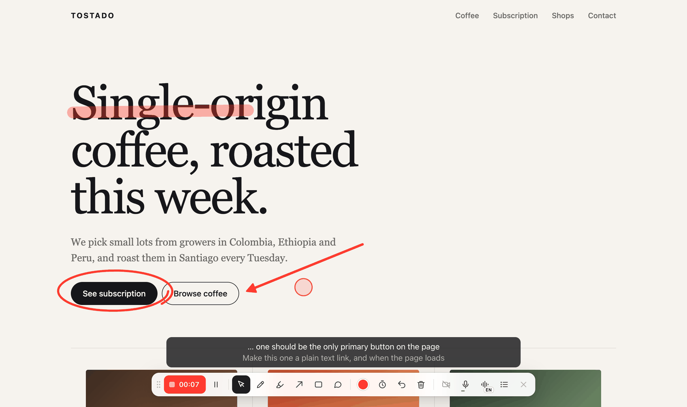
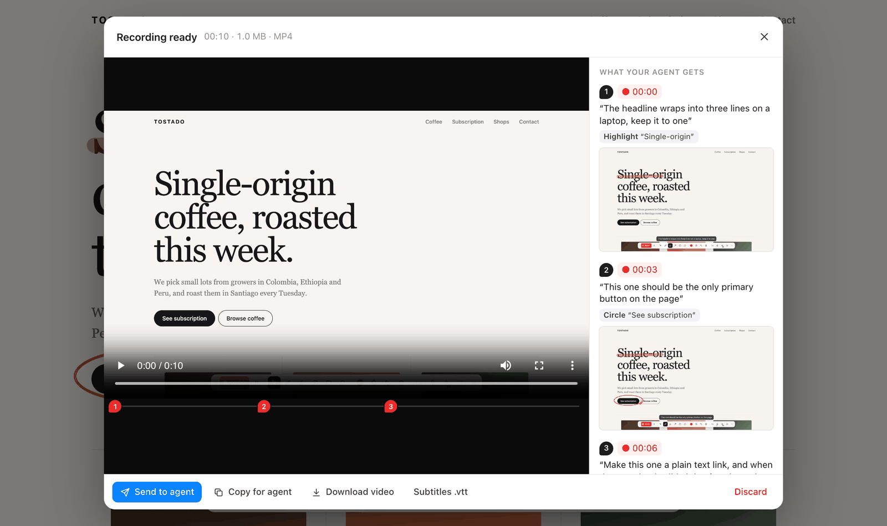

<p align="center"></p>

<h1 align="center">Garabato</h1>

<p align="center">Habla sobre una página web mientras la rayas. Tu agente recibe el feedback.</p>

<p align="center"><a href="README.md">English</a></p>

Revisa una página como lo harías con un diseñador al lado: dices qué está mal, lo encierras en un
círculo, dibujas una flecha, bosquejas cómo debería moverse algo. Garabato lo convierte en un archivo
Markdown con el que un agente puede trabajar. Cada momento junta lo que dijiste, transcrito en vivo en
español o inglés, con lo que marcaste: el selector CSS del elemento, su texto, su archivo fuente cuando
el servidor de desarrollo lo expone, y una captura con tu dibujo encima.

Levántalo como sesión sobre tu servidor de desarrollo y **Enviar al agente** le entrega el feedback
directo a tu agente, como archivos en el proyecto o por MCP. O usa la extensión de Chrome en cualquier
sitio y descárgalo.



## Úsalo con tu agente

### Sesión sobre tu servidor de desarrollo (cualquier agente)

```sh
npx github:ignaciobernardo/garabato 4321
```

Esto abre Chrome en `http://localhost:7777`, que muestra tu servidor del puerto 4321 con Garabato
encima (la recarga en caliente sigue funcionando). Aprieta **Grabar**, habla y dibuja, detén y aprieta
**Enviar al agente**. El feedback queda en `.garabato/<hora>/` como `feedback.md`, `feedback.json` y
`frames/*.jpg`, y la CLI imprime la ruta de `feedback.md`.

El destino puede ser un puerto, una URL (`http://localhost:5173/precios`), una carpeta o un archivo
HTML, o nada: Garabato busca un servidor de desarrollo en los puertos de siempre. Con `--once` termina
después del primer feedback, así un agente puede correrlo en segundo plano y leer el archivo cuando
termine.

```
garabato [destino] [--port 7777] [--out .garabato] [--once] [--no-open]
```

### MCP (Claude Code, Cursor y otros)

```sh
claude mcp add garabato -- npx -y github:ignaciobernardo/garabato mcp
```

Después pídele a tu agente algo como *"abre una revisión con Garabato del servidor de desarrollo y
espera mi feedback"*. El servidor tiene tres herramientas:

- `start_review`: abre la página en Chrome (los mismos destinos que la CLI).
- `wait_for_feedback`: espera a que aprietes **Enviar al agente** y devuelve el Markdown más las
  capturas como imágenes.
- `stop_review`

### Extensión de Chrome (cualquier sitio)

Garabato todavía no está en la Chrome Web Store, así que se carga sin empaquetar:

1. Clona o [descarga](https://github.com/ignaciobernardo/garabato/archive/refs/heads/main.zip) este repo.
2. Abre `chrome://extensions`, activa **Modo de desarrollador** y haz clic en
   **Cargar extensión sin empaquetar**. Elige la carpeta `extension`.
3. Fija Garabato desde el ícono de pieza de puzzle junto a la barra de direcciones.

En cualquier página, haz clic en el ícono o presiona **Alt+Shift+G**. Al detener la grabación,
**Descargar feedback** guarda un `.zip` con los mismos archivos, y **Copiar para el agente** copia el
Markdown para pegarlo en un chat.

## Lo que recibe tu agente



Al detener, la revisión muestra cada momento tal como lo va a recibir el agente. `feedback.md` se ve así:

```md
## 2 · 00:03

> Este debería ser el único botón principal de la página

- **Circled** `div.wrap > section.hero > a.btn` (“See subscription”)


```

La estructura del archivo está en inglés para cualquier agente; lo que dijiste queda en el idioma en
que lo dijiste. Garabato lee cada marca como algo accionable:

| Dibujas | El agente lee |
|---|---|
| Destacador sobre un texto | las palabras exactas que destacaste y su elemento |
| Una línea bajo un texto | las palabras subrayadas |
| Un círculo o un recuadro | el elemento que encierra, o las palabras que cruza |
| Una flecha | el elemento al que apunta y su dirección |
| Cualquier otra cosa | un dibujo libre: los elementos debajo y su trazo en coordenadas de la página, útil para animaciones |
| Un comentario | tu texto, anclado a un elemento |

Lo que dices sin dibujar también queda como momento, con una captura de lo que había en pantalla.
`feedback.json` tiene los mismos datos estructurados, y el Markdown termina con la transcripción completa.

**La ubicación en el código** viene del servidor de desarrollo. Astro da `archivo:línea` con su barra de
desarrollo activa, y el archivo del componente si está apagada. También funcionan Svelte, Vue, React
hasta la 18 y los atributos de `code-inspector-plugin`. Lo de React, Svelte y Vue solo funciona en
sesiones, porque la extensión no puede leer los objetos de JavaScript de la página.

## Grabar y dibujar

| Tecla | Herramienta |
|---|---|
| V | Cursor (usar la página normal) |
| P | Lápiz |
| H | Destacador |
| A | Flecha (Shift = ángulos de 15°) |
| R | Rectángulo (Shift = cuadrado) |
| C | Comentario: clic en la página, escribe, ⌘↵ guarda |
| F | Tinta efímera: los trazos se borran solos a los ~3 s |
| L | Lista de comentarios |
| ⌘Z | Deshacer · Esc vuelve al cursor |

- **Grabar** pide compartir *esta pestaña* y cuenta 3-2-1. El video incluye tus dibujos, comentarios,
  la burbuja de cámara, la transcripción en vivo y un halo que sigue al puntero (Chrome no incluye el
  cursor al capturar una pestaña). El audio mezcla tu micrófono con el sonido de la pestaña.
- El botón de **transcripción** (la onda de sonido junto al micrófono) elige español o inglés, o la apaga.
- En la extensión, la **cámara** se enciende sola al grabar. En las sesiones con agente parte apagada
  para no tapar la página en las capturas; el botón de cámara la enciende.
- Los dibujos y comentarios quedan pegados al contenido al hacer scroll. Después de **Enviar al agente**,
  la página queda limpia para la siguiente ronda.

## Privacidad

- La transcripción en vivo usa el reconocimiento de voz de Chrome, que puede enviar tu audio a Google.
  Si la apagas desde el botón de transcripción, Garabato no hace ninguna petición de red.
- En una sesión, el feedback solo va al servidor local de Garabato, que lo escribe en tu proyecto. La
  extensión guarda todo en memoria hasta que lo descargas.
- La extensión pide solo `activeTab` y `scripting`. Corre en una pestaña cuando haces clic en el ícono o
  usas el atajo, y nunca lee tus otras pestañas.

## Límites

- Solo Chrome: Garabato depende de la captura de pestaña con `preferCurrentTab` y del reconocimiento de
  voz de Chrome.
- Si navegas a otra URL durante la grabación, se pierde. Las navegaciones dentro de apps de una sola
  página no la cortan.
- La extensión no funciona en páginas `chrome://`, la Chrome Web Store ni el visor de PDF.
- Las sesiones funcionan mejor con servidores de desarrollo locales. Se puede usar un sitio remoto, pero
  los links a su propio dominio te sacan de la sesión.

## Cómo funciona

- `extension/garabato.js` es toda la herramienta: un archivo, sin dependencias ni build. Dibuja su
  interfaz en un Shadow DOM y funciona como content script de la extensión o como `<script>` normal.
- Cada marca se interpreta al terminar de dibujarla: hit-testing bajo la capa de dibujo,
  `caretRangeFromPoint` para las palabras exactas y las pistas del servidor de desarrollo sobre el
  código. Las capturas salen de la misma grabación, una por cada ráfaga de marcas.
- `cli/garabato.mjs` es el servidor de sesión y el servidor MCP, sin dependencias. Hace de proxy hacia
  tu servidor de desarrollo (WebSockets incluidos), inyecta el script y guarda lo que envías.
- `extension/player.html` reproduce el video de revisión desde el origen de la extensión, para que un
  CSP estricto (como el de GitHub) no lo bloquee.

## Contribuir

Issues y pull requests bienvenidos. No hay nada que compilar: para la extensión, edita
`extension/garabato.js` y recárgala en `chrome://extensions`. Para las sesiones, corre
`node cli/garabato.mjs demo` y recarga la página. Los textos de la interfaz están en el objeto `T` al
comienzo de `garabato.js`; se agradecen más idiomas. `scripts/pack.sh` arma el .zip para la Chrome Web
Store.

## Licencia

[MIT](LICENSE)
