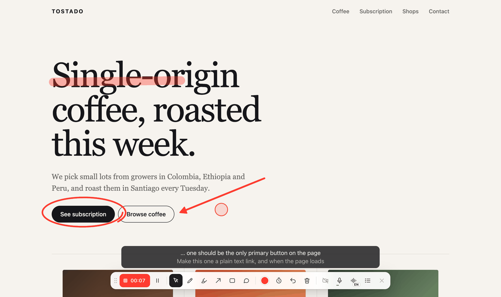
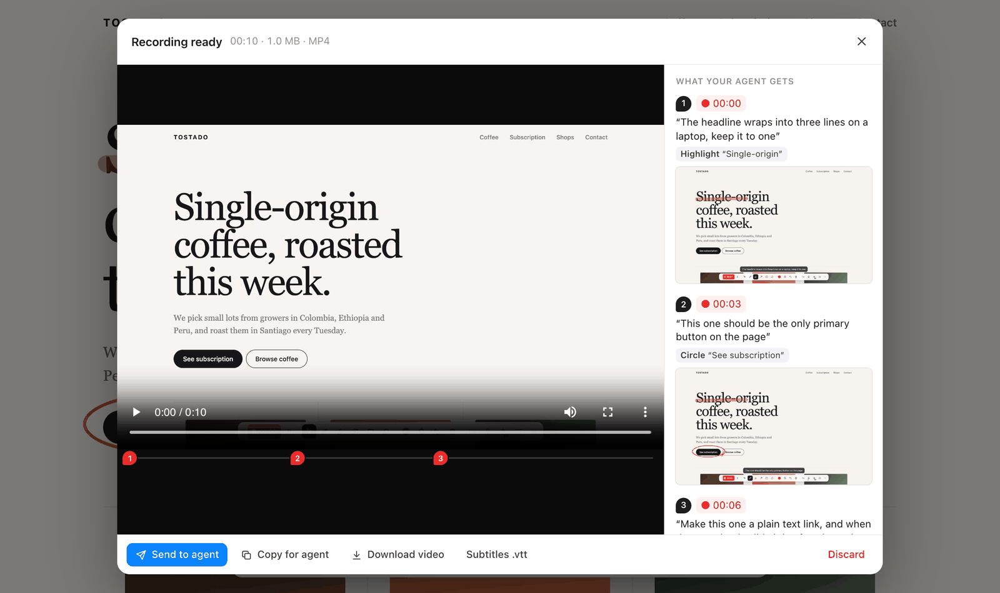

<p align="center"></p>

<h1 align="center">Garabato</h1>

<p align="center">Talk through a web page while you draw on it. Your coding agent gets the feedback.</p>

<p align="center"><a href="README.es.md">Español</a></p>

Review a page the way you would with a designer next to you: say what's wrong, circle it, draw an
arrow, sketch how something should move. Garabato (Spanish for *scribble*) turns that into a
Markdown file an agent can act on. Every moment pairs what you said, transcribed live in Spanish or
English, with what you marked: the element's CSS selector, its text, its source file when the dev
server exposes it, and a screenshot with your drawing on it.

Run it as a session on your dev server and **Send to agent** delivers the feedback straight to your
agent, as files in the project or through MCP. Or use the Chrome extension on any site and download it.



## Use it with your agent

### Session on your dev server (any agent)

```sh
npx github:ignaciobernardo/garabato 4321
```

This opens Chrome on `http://localhost:7777`, which shows your dev server on port 4321 with Garabato
on top (hot reload keeps working). Hit **Record**, talk and draw, stop, and press **Send to agent**.
The feedback lands in `.garabato/<time>/` as `feedback.md`, `feedback.json` and `frames/*.jpg`, and
the CLI prints the path of `feedback.md`.

The target can be a port, a URL (`http://localhost:5173/pricing`), a folder or an HTML file, or
nothing at all: Garabato looks for a dev server on the usual ports. With `--once` it exits after the
first feedback, so an agent can run it in the background and read the file when it finishes.

```
garabato [target] [--port 7777] [--out .garabato] [--once] [--no-open]
```

### MCP (Claude Code, Cursor, and others)

```sh
claude mcp add garabato -- npx -y github:ignaciobernardo/garabato mcp
```

Then ask your agent something like *"open a Garabato review of the dev server and wait for my
feedback"*. The server has three tools:

- `start_review`: opens the page in Chrome (same targets as the CLI).
- `wait_for_feedback`: waits until you press **Send to agent** and returns the Markdown plus the
  screenshots as images.
- `stop_review`

### Chrome extension (any site)

Garabato isn't on the Chrome Web Store yet, so load it unpacked:

1. Clone or [download](https://github.com/ignaciobernardo/garabato/archive/refs/heads/main.zip) this repo.
2. Open `chrome://extensions`, turn on **Developer mode** and click **Load unpacked**. Pick the
   `extension` folder.
3. Pin Garabato from the puzzle-piece menu next to the address bar.

On any page, click the icon or press **Alt+Shift+G**. When you stop recording, **Download feedback**
saves a `.zip` with the same files, and **Copy for agent** copies the Markdown so you can paste it
into a chat.

## What your agent gets



When you stop, the review shows each moment the way the agent will receive it. `feedback.md` looks
like this:

```md
## 2 · 00:03

> This one should be the only primary button on the page

- **Circled** `div.wrap > section.hero > a.btn` (“See subscription”)


## 3 · 00:06

> Make this one a plain text link, and when the page loads slide it in after the main button

- **Arrow** pointing down-left at `div.wrap > section.hero > a.btn.alt` (“Browse coffee”)


```

Garabato reads each mark as something you can act on:

| You draw | The agent reads |
|---|---|
| Highlighter over text | the exact words you highlighted and their element |
| A line under text | the underlined words |
| A loop or a box | the element it surrounds, or the words it cuts through |
| An arrow | the element it points at, and its direction |
| Anything else | a freehand sketch: the elements under it and its path in page coordinates, useful for motion |
| A comment | your text, pinned to an element |

Things you say without drawing still become moments, each with a screenshot of what was on screen.
`feedback.json` has the same data, structured, and the full transcript closes the Markdown file.

**Source locations** come from the dev server. Astro shows `file:line` when its dev toolbar is on,
and the component file when it's off. Svelte, Vue, React up to 18, and the `code-inspector-plugin`
attributes also work. The React, Svelte and Vue lookups only run in sessions, because the extension
can't read the page's own JavaScript objects.

## Recording and drawing

| Key | Tool |
|---|---|
| V | Cursor (use the page normally) |
| P | Pen |
| H | Highlighter |
| A | Arrow (Shift snaps to 15°) |
| R | Rectangle (Shift for a square) |
| C | Comment: click the page, type, ⌘↵ to save |
| F | Fading ink: strokes clear themselves after ~3 s |
| L | Comment list |
| ⌘Z | Undo · Esc goes back to the cursor |

- **Record** asks you to share *this tab* and counts down 3-2-1. The video includes your drawings,
  comments, camera bubble, the live transcript, and a halo that follows your pointer (Chrome leaves the
  cursor out of tab captures). The audio mixes your mic with the tab's sound.
- The **transcript** button (the sound-wave icon next to the mic) picks Spanish or English, or turns
  transcription off.
- In the extension, the **camera** turns on by itself when you record. In agent sessions it starts off
  so it doesn't cover the page in the screenshots; click the camera button to turn it on.
- Drawings and comments stick to the content when you scroll. After **Send to agent**, the page clears
  for the next round.

## Privacy

- Live transcription uses Chrome's speech recognition, which may send your audio to Google. Turn it
  off from the transcript button and Garabato makes no network requests.
- In a session, feedback goes only to the local Garabato server, which writes it into your project.
  The extension keeps everything in memory until you download it.
- The extension asks for `activeTab` and `scripting` only. It runs on a tab when you click its icon or
  press the shortcut, and never reads your other tabs.

## Limits

- Chrome only: Garabato relies on tab capture with `preferCurrentTab` and on Chrome's speech
  recognition.
- Navigating to another URL during a recording loses it. Route changes inside single-page apps are fine.
- The extension can't run on `chrome://` pages, the Chrome Web Store or the PDF viewer.
- Sessions work best with local dev servers. A remote site can be proxied, but links to its own
  domain take you out of the session.

## How it works

- `extension/garabato.js` is the whole tool: one file, no dependencies, no build step. It draws its UI
  in a Shadow DOM and works as an extension content script or as a plain `<script>` tag.
- Each mark is resolved when you finish drawing it: hit-testing under the overlay, `caretRangeFromPoint`
  for the exact words, and the dev server's source hints. Screenshots come from the recording itself,
  one per burst of marks.
- `cli/garabato.mjs` is the session server and the MCP server, with no dependencies. It proxies your dev
  server (WebSockets included), injects the script, and saves what you send.
- `extension/player.html` plays the review video from the extension's own origin, so a strict Content
  Security Policy (GitHub's, for example) can't block it.

## Contributing

Issues and pull requests are welcome. Nothing needs building: for the extension, edit
`extension/garabato.js` and click reload on Garabato's card in `chrome://extensions`. For sessions,
run `node cli/garabato.mjs demo` and reload the page. The UI strings live in the `T` object at the top
of `garabato.js`; more languages are welcome. `scripts/pack.sh` zips the extension for the Chrome Web
Store.

## License

[MIT](LICENSE)
